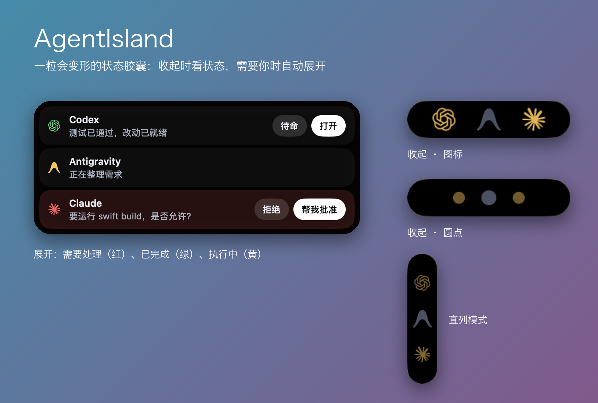
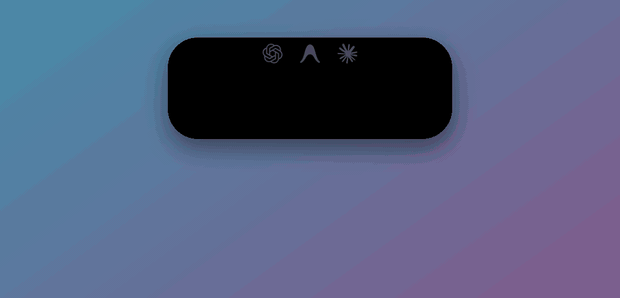
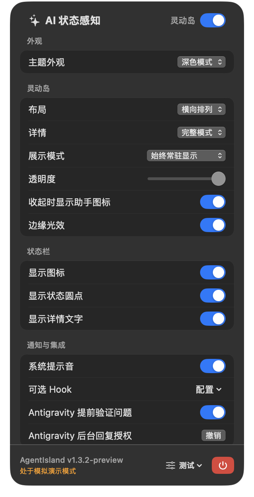

# AgentIsland

AgentIsland 是 macOS 上的 AI 编程助手状态悬浮窗：在菜单栏和屏幕上的灵动岛式悬浮窗里显示各助手的执行状态与待处理问题，并在能确认目标会话时直接回复。需要 macOS 14 或更新版本，当前版本 **1.3.2**。



<p align="center"></p>

*图片中的助手名称、状态文字和对话内容都是演示用的虚构数据。*

**In English:** AgentIsland is a macOS (14+) floating HUD, styled like the iPhone Dynamic Island, that shows what your AI coding assistants (Codex, Antigravity, Claude Code; experimental: Cursor, Windsurf, Trae) are doing. It stays a small capsule of status lights, and opens by itself when an assistant needs you or has finished. Interface text is in Chinese. Builds are ad-hoc signed and not notarized, and there is no public release yet; see the status section below.

## 状态

目前尚无公开 Release。构建使用临时（ad-hoc）签名、未公证，也没有在干净的机器上验证过，因此还不适合作为开箱即用的公开发行版。验证范围、已知限制与发布顺序见 [开发交接与路线图](docs/PROJECT-HANDOFF.md)，接手的开发者或 AI 请先读它。

## 支持范围

| 助手 | 能力 | 限制 |
| --- | --- | --- |
| Codex Desktop | 状态、问题、文本回复和一次性审批 | 依赖非公开的本机 IPC，桌面端版本变化后需要重新验证。只保留最新回合中未回答的问题；更早回合留下的旧问题视为历史，不再显示 |
| Antigravity | 状态、问题展示和后台回复 | 依赖未公开接口，仅允许桌面版 2.27.0、2.28.0、2.28.2、2.29.0。2.29.0 的问题结构已对照一个实际等待中的问题验证，单台 Mac 的使用者反馈可用；文字回复没有独立样本，更多环境仍待验证 |
| Claude Code | 状态、问题（含真实文字与选项）；安装可选 Hook 后可靠显示等待授权 | 实验性。从会话记录读取状态，不能凭记录判断是否在等待授权，需要 Hook |
| Cursor、Windsurf、Trae | 实验性状态监控 | 各助手能力不同，未完成独立验收 |

红色表示需要操作，黄色表示执行中，绿色表示完成。状态反映可获得的事件，不保证助手已经收到操作。

## 悬浮窗外观

悬浮窗是一粒会变形的黑色胶囊，风格接近 iPhone 的灵动岛，详见 [docs/hud-style.md](docs/hud-style.md)：

- **收起**时每个助手一个状态点；执行中的会缓缓呼吸。可在设置里改成显示助手图标，展开后各行的前导标志也跟着用图标或圆点。
- **自动展开**：有会话需要处理（红）或已完成未查看（绿）时展开成行列表。点胶囊可手动展开或收起；已点收起的那几项不会再弹出，直到有新的。
- 开合用弹簧动画，窗口中心保持不动；系统开启「减弱动态效果」时直接切换。
- **边缘光效**：胶囊外沿一圈细光边，红（呼吸）、黄、绿，全部待命时是淡白，可在设置中关闭。
- **直列模式**：收起的胶囊变成竖条，圆点或图标从上到下排。

## 设置面板

点菜单栏图标打开（下图），分四组：**外观**（主题）、**灵动岛**（布局、详情、展示模式、透明度、收起时显示助手图标、边缘光效）、**状态栏**（图标、状态圆点、详情文字）、**通知与集成**（提示音、可选 Hook、Antigravity 提前验证与授权）。

<p align="center"></p>

行上的「打开」会去到会话实际所在的应用：Codex 跳到对应线程，Antigravity 尽量跳到对应会话并把已完成的标为已查看，Claude 按会话来源打开桌面应用或终端（Claude 桌面端没有指向单个会话的链接，只能把应用带到前台）。

### 悬浮窗里有几行

一个会话只有在有东西可看时才占一行：需操作、执行中、失败，或已完成但还没查看。已查看或空闲的会话不占位，折回该助手唯一的图标；点完成行的「已查看／待命」后那一行就消失。同一个助手需要注意的会话超过 3 个时，最需要你的 3 个保留自己的行，其余折成一个「+N」标记，点开可看清单。详见 [docs/hud-session-rows.md](docs/hud-session-rows.md)。

多个 Claude Code 会话同时存在时，行上的批准与拒绝只会打开原窗口，不会盲打按键：按键无法确定送到哪一个终端。

Antigravity 完成后保留「已完成」提示直到你查看。问题被取消或对话被关闭后，若服务器确认它不再等待，就不再显示为需操作；这需要启用「Antigravity 提前验证问题」，或打开过该问题的面板。

## 获取和安装

构建、校验、安装与卸载步骤见 [安装说明](docs/install.md)。临时签名与辅助功能授权的关系也在其中：每次更新后授权可能需要重新添加。

## 从源码构建

需要 macOS 14+、Xcode 及 Swift 6。开发测试使用 Python；应用本身及 Codex、Antigravity、Claude Code 的原生 Hook 安装与运行不需要 Python，Cursor／Windsurf 的实验性 Hook 工具仍需要。

```sh
bash scripts/test.sh                      # Swift 与 Python 测试
bash scripts/build_app.sh                 # 正式渠道  -> build-output/release/AgentIsland.app
bash scripts/build_isolated_preview.sh    # 隔离预览  -> build-output/preview/AgentIsland.app
bash scripts/package.sh                   # 打包 zip、校验值与安装说明 -> dist/
```

版本号只写在根目录的 `VERSION`。两个渠道互不共用状态：正式渠道的 bundle id 是 `io.github.r3dra1n.AgentIsland`，显示 `1.3.2`；隔离预览使用 `local.agentisland.isolatedpreview`，显示 `1.3.2-preview`，有自己的偏好与进程锁，可与正式版同时运行，窗口上标有「隔离测试版」。

## Hook 与隐私

Codex 的原生 IPC 不需要 Hook。Codex、Antigravity 和 Claude Code 的可选 Hook 都在应用设置的「可选 Hook」中配置，使用原生记录器，运行时不需要 Python；首次配置仍需确认目标助手版本实际使用的配置文件位置。[Hook 说明](integrations/README.md)描述配置、备份与移除。

AgentIsland 在本机读取日志、会话记录及必要的界面／IPC 信息，可能在悬浮窗显示问题或命令。不要公开真实会话、审批内容、密钥、配置或未经检查的截图。详情见 [隐私说明](PRIVACY.md)。

Antigravity 的后台回复首次使用时需明确同意：应用会临时读取其本机语言服务器的认证令牌，并查询待回答的本机会话；令牌不保存、不上传。可在设置中撤销授权。「Antigravity 提前验证问题」默认关闭，启用后会在检测到待回答问题时提前做同样的本机查询；它不会自动发送回复。

后台回复只开放明确验证过的版本。应用更新到其他版本时，状态监测可能仍可用，但后台回复会暂停并提示版本尚未验证，请先在 Antigravity 原窗口回答；AgentIsland 不会因版本接近而自动放行。

## 开发与反馈

提交前运行 `python3 scripts/check_public_source.py` 与 `bash scripts/test.sh`。前者只扫描部分常见敏感内容，不能替代历史、二进制、截图或人工审查。请按 [安全反馈](SECURITY.md) 私下报告敏感问题，遵循 [贡献指南](CONTRIBUTING.md)。

本项目使用 [MIT](LICENSE)；第三方素材及商标说明见 [NOTICES](Resources/NOTICES.md)。

界面里的助手图标来自 [LobeHub/lobe-icons](https://github.com/lobehub/lobe-icons)（MIT），仅用于识别对应产品；Codex／OpenAI、Claude／Anthropic、Cursor、Antigravity／Google、Windsurf、Trae 的名称与商标归各自所有者，本项目与它们没有关联，也未获其认可。
